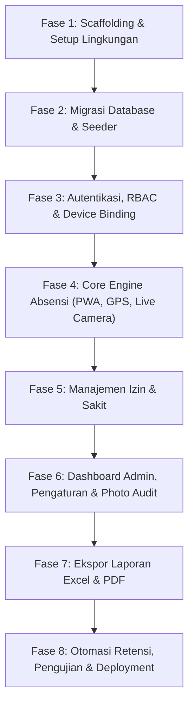

# Implementation Plan: Aptiva Attend (Sistem Absensi Guru & Staf Sekolah)

Dokumen ini merupakan panduan implementasi teknis langkah-demi-langkah (*step-by-step implementation plan*) untuk membangun **Aptiva Attend** sesuai dengan spesifikasi [PRD v1.2](./prd_mvp_aplikasi_absensi_guru_aptiva_digital.md).

---

## 1. Ikhtisar Arsitektur & Tech Stack
* **Backend:** Laravel 11.x (**PHP 8.3+ / 8.4** — Rekomendasi $\ge$ PHP 8.3.8+ patched release bebas CVE-2024-4577 & leak keamanan)
* **Frontend:** Inertia.js + React 18 + Tailwind CSS
* **Mobile / PWA Engine:** Vite PWA Plugin / Service Worker + Web App Manifest
* **Database:** MySQL 8.0+
* **Storage:** Local Disk Storage (`storage/app/public/`) dengan `php artisan storage:link`
* **Arsitektur:** Single-Tenant (Dedicated per instansi sekolah)

---

## 1.1 Standar Keamanan PHP & Server Hardening (Mitigasi Celah & Kebocoran)
Mengingat adanya kerentanan kritis terkini pada ekosistem PHP di internet (seperti **CVE-2024-4577** *CGI Argument Injection RCE*, *Information Disclosure*, dan *Memory Leak*), aplikasi ini mewajibkan konfigurasi keamanan berikut:

1. **Versi & Mode Eksekusi PHP:**
   * Wajib menggunakan **PHP 8.3.8+ atau PHP 8.4** (versi yang telah menambal resmi celah argument injection dan kebocoran buffer).
   * **Dilarang keras** menggunakan mode *PHP-CGI* langsung di Apache/Nginx. Wajib menggunakan **PHP-FPM (FastCGI Process Manager)** terisolasi.
2. **Konfigurasi `php.ini` Hardening (Anti-Kebocoran Informasi & Anti-RCE):**
   * `expose_php = Off` $\rightarrow$ Menyembunyikan header `X-Powered-By: PHP/8.x` agar penyerang tidak dapat memetakan versi PHP sistem.
   * `display_errors = Off` & `display_startup_errors = Off` $\rightarrow$ Mencegah kebocoran struktur folder, query SQL, atau kredensial database ke layar pengguna saat terjadi error.
   * `log_errors = On` $\rightarrow$ Seluruh pesan error hanya dicatat ke log server internal terenkripsi.
   * `disable_functions = exec,passthru,shell_exec,system,proc_open,popen,curl_multi_exec,parse_ini_file,show_source` $\rightarrow$ Mematikan eksekusi perintah shell berbahaya di server jika terjadi celah kode.
   * `allow_url_fopen = Off` & `allow_url_include = Off` $\rightarrow$ Mencegah eksploitasi Remote File Inclusion (RFI).
3. **Session & Cookie Hardening:**
   * `session.cookie_httponly = 1` $\rightarrow$ Mencegah pencurian session cookie melalui serangan XSS (Cross-Site Scripting).
   * `session.cookie_secure = 1` $\rightarrow$ Cookie hanya ditransmisikan melalui protokol terenkripsi HTTPS.
   * `session.cookie_samesite = "Strict"` $\rightarrow$ Perlindungan penuh terhadap serangan CSRF (Cross-Site Request Forgery).
4. **Proteksi File Upload & Eksekusi Script:**
   * Validasi MIME-type di sisi server menggunakan *magic byte inspection* (`image/jpeg`, `image/webp`, `image/png`, `application/pdf`), bukan sekadar memeriksa ekstensi nama file.
   * Nama file di-*rename* menjadi UUID hash acak sebelum disimpan.
   * Blokir eksekusi file `.php` di dalam direktori publik `storage/` melalui konfigurasi Web Server (Nginx / Apache `.htaccess`).
5. **Security Headers & Rate Limiting (Laravel 11):**
   * Middleware Security Headers: `X-Frame-Options: DENY`, `X-Content-Type-Options: nosniff`, `Strict-Transport-Security: max-age=31536000; includeSubDomains`, dan `Content-Security-Policy`.
   * Rate limiting ketat pada endpoint `/login` (maksimal 5 percobaan per menit per IP) dan endpoint absensi `/api/attendance/*` untuk menangkal serangan brute-force maupun *denial-of-service* (DoS).

---

## 2. Roadmap Fase Implementasi

---

## 3. Rincian Fase Kerja (Task Breakdown)

### Fase 1: Scaffolding Proyek & Konfigurasi PWA
- [x] Inisialisasi proyek Laravel 11 dengan starter kit Inertia React (`laravel new aptiva-attend --breeze --stack=react` atau instalasi manual Inertia).
- [x] Konfigurasi Tailwind CSS dan komponen UI dasar (Lucide React Icons, Shadcn UI / Headless UI).
- [x] Konfigurasi PWA:
  - Buat `manifest.json` (nama aplikasi, icon 192x192 & 512x512, background_color, display: standalone).
  - Daftarkan Service Worker untuk caching aset statis dan antarmuka offline.
- [x] Konfigurasi database `.env` (MySQL connection) dan eksekusi `php artisan storage:link`.

### Fase 2: Database Migrations, Models & Seeders
- [x] Buat file migrasi untuk 7 tabel:
  1. `users` (tambahkan kolom `nip`, `phone`, `role`, `schedule_type`, `device_id`, `must_change_password`, `is_active`).
  2. `teacher_schedules` (jadwal mengajar untuk guru part-time/honorer).
  3. `school_settings` (koordinat latitude/longitude, radius, jam masuk, jam pulang, hari kerja, logo).
  4. `attendances` (transaksi absensi, koordinat, akurasi GPS, foto masuk/pulang, status, HTAP).
  5. `leave_requests` (izin, sakit, dinas luar, lampiran surat, approval status).
  6. `attendance_audit_logs` (riwayat koreksi manual oleh admin TU).
  7. `school_holidays` (daftar libur nasional dan cuti khusus sekolah).
- [x] Buat Eloquent Model lengkap dengan `casts`, `fillable`, dan relasi antar model.
- [x] Buat `DatabaseSeeder` berisi:
  - 1 Akun Admin TU (`admin@sekolah.sch.id`).
  - 1 Akun Kepala Sekolah (`kepsek@sekolah.sch.id`).
  - Data default `school_settings` (jam kerja standar 07:15, radius 100m).

### Fase 3: Autentikasi, RBAC & Device Binding
- [x] Modifikasi alur autentikasi Laravel: Login menggunakan **NIP** atau **Email** + Password.
- [x] Implementasi **Device Binding**:
  - Saat login, PWA membuat fingerprint perangkat (kombinasi User Agent + Canvas/UUID lokal tersimpan).
  - Cek kecocokan dengan `device_id` di database. Jika akun sudah terikat di perangkat lain, tolak absensi dan tampilkan pesan konfirmasi ke TU.
  - Tambahkan tombol *Reset Device ID* di dashboard Admin TU.
- [x] Implementasi Middleware:
  - `EnsurePasswordChanged`: Memaksa guru mengganti password jika `must_change_password == true`.
  - `RoleMiddleware`: Memisahkan hak akses `admin_tu`, `kepsek`, dan `guru`.
- [x] Fitur **Bulk Import Guru via Excel/CSV**:
  - Form upload Excel di panel Admin TU dengan tombol unduh template kosong.
  - Menggunakan library `maatwebsite/excel` atau `openspout/fast-excel`.
  - Generate otomatis akun guru dengan password default + flag ganti password aktif.

### Fase 4: Core Engine Absensi PWA (Kamera & Geofencing)
- [x] **Modul Kamera Langsung (In-App Stream):**
  - Implementasi komponen React kamera depan via `navigator.mediaDevices.getUserMedia()`.
  - Tangkap frame ke kanvas HTML5 (tanpa input file galeri).
  - Render watermark otomatis pada kanvas: *Nama, NIP, Waktu Server, GPS, Status*.
  - Kompresi sisi klien ke WebP/JPEG (resolusi max 800x800, ukuran $\le 150\text{ KB}$).
- [x] **Modul Geofencing & Anti-Fake GPS:**
  - Ambil lokasi pengguna via `navigator.geolocation.getCurrentPosition({ enableHighAccuracy: true })`.
  - Validasi akurasi: Tolak jika `coords.accuracy > 50` meter.
  - Hitung jarak terhadap koordinat sekolah menggunakan fungsi Haversine di server/client.
  - Aktifkan tombol absen hanya jika berada di dalam radius toleransi sekolah.
- [x] **Backend Transaction & Logika Waktu:**
  - Endpoint `POST /attendance/check-in`: Validasi jam server ($\le$ jam masuk $\rightarrow$ Tepat Waktu, $>$ jam masuk $\rightarrow$ Terlambat). Simpan foto ke `storage/app/public/attendances/`.
  - Endpoint `POST /attendance/check-out`: Buka tombol pulang hanya jika waktu server $\ge$ `checkout_start` (misal 13:00).
  - Penanganan anti-double submit (token idempotent).

### Fase 5: Pengajuan Izin, Sakit & Dinas Luar
- [x] **Antarmuka Guru:**
  - Form pengajuan izin/sakit/dinas luar: pilih tipe, tanggal mulai/selesai, catatan, dan upload bukti foto/PDF.
  - Fitur pengajuan sakit darurat tanpa lampiran dengan batas waktu susulan $1 \times 24$ jam.
  - Riwayat status pengajuan (*Pending*, *Approved*, *Rejected*).
- [x] **Workflow Persetujuan Admin TU:**
  - Daftar permohonan masuk dengan tombol *Approve* dan *Reject* (dengan form alasan).
  - Saat disetujui, sistem otomatis mencatat status di tabel `attendances` untuk rentang tanggal yang diajukan.

### Fase 6: Dashboard Admin, Pengaturan & Photo Audit Grid
- [x] **Dashboard Ringkasan Hari Ini:**
  - Kartu statistik kehadiran real-time: Hadir, Terlambat, Izin/Sakit, HTAP, Belum Absen.
  - **Photo Audit Grid:** Halaman galeri thumbnail foto selfie guru yang masuk hari ini untuk inspeksi visual cepat oleh TU/Kepsek.
- [x] **Koreksi Presensi Manual & Audit Trail:**
  - Modal form koreksi status absen oleh Admin TU jika terjadi kendala HP darurat.
  - Catat log perubahan secara otomatis ke tabel `attendance_audit_logs`.
- [x] **Pengaturan Sekolah (Settings):**
  - Pin map interaktif (Leaflet / OpenStreetMap / Google Maps) untuk menentukan titik koordinat & radius.
  - Pengaturan jam kerja, jam pulang, opsi 5/6 hari kerja, dan kalender libur.
  - Pengaturan hari aktif mengajar untuk masing-masing guru part-time/honorer.

### Fase 7: Ekspor Laporan Bulanan (Excel & PDF)
- [x] **Laporan Excel (`.xlsx`):**
  - Mengenerate lembar kerja matriks presensi bulanan (kolom tanggal 1 s/d 31 untuk setiap guru).
  - Rekap total kolom: Hadir, Telat, Sakit, Izin, Dinas Luar, HTAP, Alpa.
- [x] **Laporan PDF Siap Cetak:**
  - Template PDF rapi menggunakan `barryvdh/laravel-dompdf` atau Browsershot.
  - Dilengkapi Kop Surat Sekolah, logo, tabel ringkasan, dan kolom tanda tangan Kepala Sekolah & TU.

### Fase 8: Otomasi, Pengujian & Persiapan Deployment
- [x] **Otomasi Pembersihan Penyimpanan (Cron Job):**
  - Buat Artisan command: `attendance:prune-photos` yang menghapus file foto fisik berumur $> 90$ hari dari disk server.
  - Daftarkan ke Laravel Task Scheduler (`routes/console.php`).
- [x] **Otomasi Penutupan Hari (Cron Job HTAP):**
  - Command harian pukul 23:59 untuk menandai guru yang absen masuk tapi tidak absen pulang menjadi status **HTAP**.
- [x] **Pengujian & Validasi:**
  - Uji kompatibilitas PWA di Android Chrome dan iOS Safari.
  - Uji penolakan Fake GPS dan penolakan upload galeri.
  - Uji kecepatan respon pada skenario lonjakan akses pagi hari.
- [x] **Checklist Siap Deploy:**
  - Konfigurasi Web Server (Nginx + PHP-FPM + SSL/HTTPS wajib untuk fitur Web Geolocation & Camera).
  - Cron job server aktif (`* * * * * php /path-to-app/artisan schedule:run`).

---

## 4. Estimasi Waktu & Milestone

| Sprint / Milestone | Cakupan Pekerjaan | Estimasi Waktu |
| :--- | :--- | :--- |
| **Sprint 1** | Fase 1 & Fase 2: Setup Proyek, PWA dasar, Database, dan Model Seeder | 2 - 3 Hari |
| **Sprint 2** | Fase 3: Autentikasi, Device Binding, dan Bulk Import Excel Guru | 2 - 3 Hari |
| **Sprint 3** | Fase 4: Core Engine Absensi (Kamera Canvas, Geofencing, Check-in/out) | 4 - 5 Hari |
| **Sprint 4** | Fase 5 & Fase 6: Modul Izin, Dashboard, Photo Audit Grid & Audit Trail | 3 - 4 Hari |
| **Sprint 5** | Fase 7 & Fase 8: Laporan Excel/PDF, Scheduled Cron, dan Testing | 3 - 4 Hari |
| **Total Estimasi** | **MVP Siap Diuji Coba di Sekolah (Go-Live)** | **~2.5 s/d 3 Minggu** |
